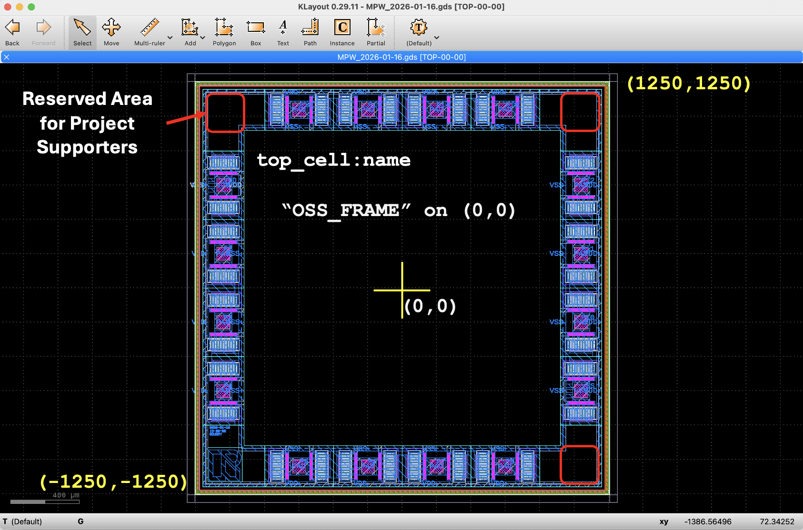
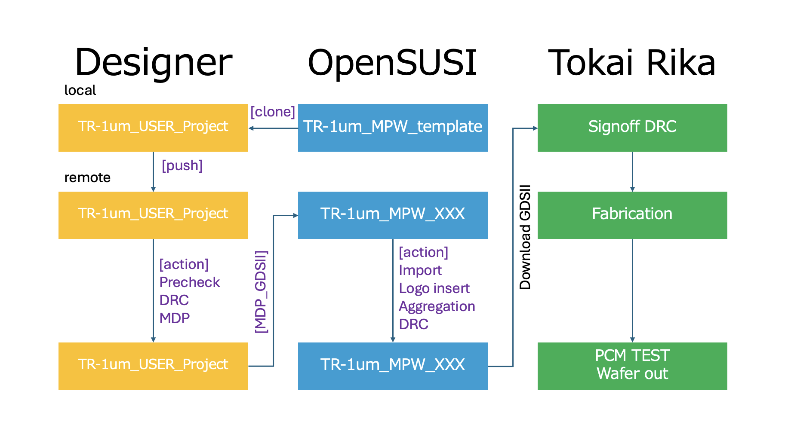

# TR-1um MPW Template

[](https://github.com/OpenSUSI/TR-1um_MPW_template/actions/workflows/check.yml)


- [Full documentation](docs/info.md)

---

## Quick Start

1. Fork this repository
2. Edit `info.yaml`
   - set `gds.top_cell` (must start with `tr_1um_`, e.g. `tr_1um_<github_username>`)
   - fill in `project` (title / author / description)
3. Place your files in `src/`
   - `<top_cell>.gds`
   - `<top_cell>.cir`
4. Push to GitHub

→ CI will automatically run **Pre-check / DRC / LVS / MDP**

---

## Source Files

Place your design files in the `src/` directory:

- `<top_cell>.gds` : layout file
- `<top_cell>.cir` : circuit netlist

⚠️ The file name must match `gds.top_cell` in `info.yaml`.



---

## Configuration (info.yaml)

The project is configured via `info.yaml`.

Key fields:

- `gds.top_cell` : top cell name (must match GDS)
- `gds.extension` : layout file extension
- `lvs.extension` : netlist file extension
- `lvs.netlist_only` : enable/disable LVS comparison
- `mdp.file` : output MDP GDS file name
- `pdk.repo` : PDK repository
- `pdk.ref` : PDK version
- `pdk.dir` : ruleset directory

See [docs/info.md](docs/info.md) for full details.

---

## CI Workflow

The GitHub Actions pipeline automatically validates your design.



---

### Pre-check

Validates `info.yaml`:

- `gds.top_cell` starts with `tr_1um_` and uses only letters, digits and `_` (**error** otherwise)
- Warns if `gds.top_cell` is still the template value `tr_1um_username`
- Warns if `project.title` / `project.author` / `project.description` are empty

Validates the layout (`src/<top_cell>.gds`):

- Top cell name matches `info.yaml (gds.top_cell)`
- Exactly one top-level cell exists
- Database unit (dbu) is `0.001 µm`
- Layout bounding box is exactly `(-1250, -1250) – (1250, 1250) µm`
  (2500 µm × 2500 µm die, centered at the origin)
- One of the OpenSUSI frame cells is **instantiated** under the top cell:
  `OSS_FRAME`, `OSS_FRAME_TEG` or `OSS_FRAME_GIO`
  (a frame cell that exists in the GDS but is not placed does not count)

---

### DRC

Runs the PDK design-rule deck (`klayout/tech/drc/run.drc`) on your layout.

- Report: `<top_cell>.lyrdb` → artifact **DRC_report**
- The job fails if any violation is reported.

---

### LVS

Compares the extracted layout netlist with `src/<top_cell>.cir`
(`klayout/tech/lvs/run.lvs`).

- Extracted netlist: `<top_cell>.extracted` → artifact **Extracted**
- `lvs.netlist_only: true` → extraction only (no comparison)
- The job fails if the netlists don't match.

---

### MDP

Generates the mask data (`klayout/tech/drc/run_mdp.drc`) and runs the
IP62 DRC (`klayout/tech/drc/run_IP62.drc`) on the result.

- Mask data: `mdp/<mdp.file>` → artifact **GDSII_MDP**
- IP62 DRC report → artifact **DRC_report_MDP**
- The job fails if the MDP output is missing or IP62 DRC reports violations.

---

## Artifacts

Download from the **Actions** tab → select a run → **Artifacts**.

| Artifact | Job | Content |
|----------|-----|---------|
| `GDSII_drawing`  | Pre-check | Submitted layout (`<top_cell>.gds`) |
| `DRC_report`     | DRC       | DRC report (`<top_cell>.lyrdb`) |
| `Extracted`      | LVS       | Extracted netlist (`<top_cell>.extracted`) |
| `DRC_report_MDP` | MDP       | IP62 DRC report on MDP output |
| `GDSII_MDP`      | MDP       | Mask data (`<mdp.file>`) |

`.lyrdb` reports can be opened in KLayout: **Tools → Marker Browser → File → Open**.

---

## Run checks locally

```bash
# KLayout 0.30.9 (same as CI)
python3 -m pip install klayout==0.30.9 pyyaml click

# PDK ruleset (use the same ref as info.yaml: pdk.ref)
git clone --depth 1 --branch v1.2609.0 https://github.com/OpenSUSI/TR-1um.git TR-1um

# Pre-check
python3 scripts/pre_check.py --top tr_1um_username src/tr_1um_username.gds

# DRC
klayout -b -r TR-1um/libs.tech/klayout/tech/drc/run.drc \
  -rd input=src/tr_1um_username.gds \
  -rd top_cell=tr_1um_username \
  -rd report=tr_1um_username.lyrdb
```

Replace `tr_1um_username` with your top cell name.

---

## CI Environment

- Runner: `ubuntu-24.04`
- KLayout: `0.30.9` (`KLAYOUT_VERSION` in `.github/workflows/check.yml`)
- PDK: pinned by `pdk.ref` in `info.yaml`

---

## License

[Apache License 2.0](LICENSE)
